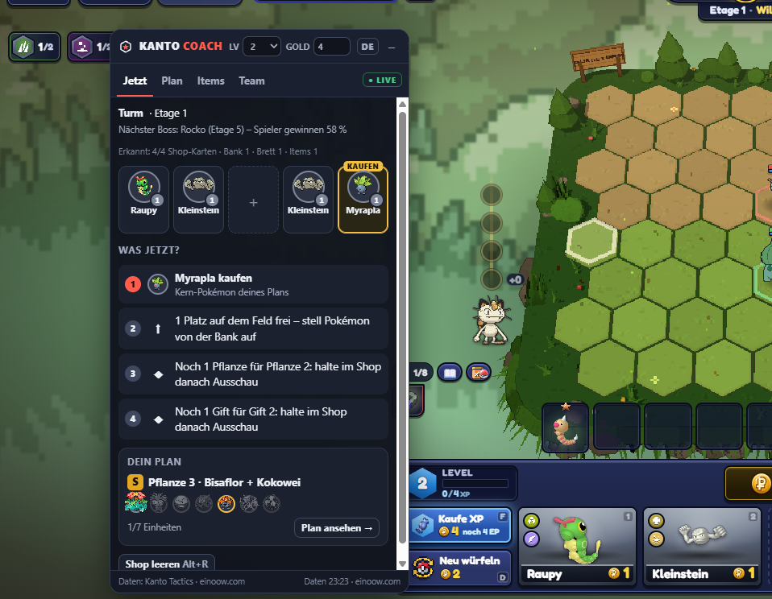
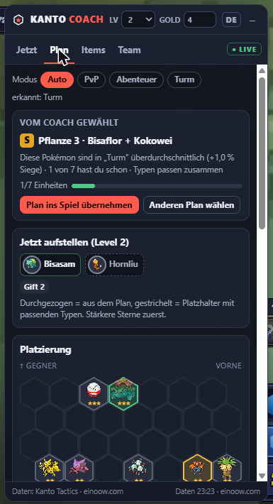
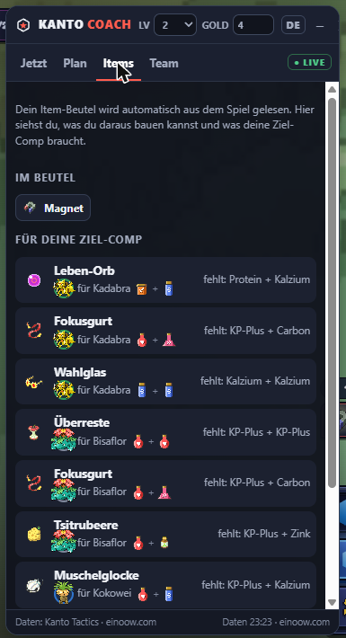
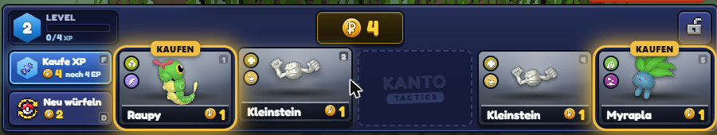

<h1 align="center">Kanto Coach</h1>

<b>Inoffizielles Overlay für <a href="https://einoow.com/kanto-tactics">Kanto Tactics</a> – damit du öfter gewinnst.</b> 
<a href="README.md">English</a> · Deutsch · <a href="https://hrvatska157-art.github.io/kanto-coach/?lang=de">Webseite</a>

<a href="https://github.com/hrvatska157-art/kanto-coach/releases/latest/download/kanto-coach-extension.zip"><b>⬇ Download (Version 2.7.0 Beta)</b></a>

---

Kanto Coach ist eine Chrome-Erweiterung, die neben dem Spiel ein kleines Overlay einblendet. Sie liest, was im Spiel sichtbar ist – Shop, Bank, Brett, Item-Beutel, Level, Gold und Runde – und sagt dir in jeder Runde, **was du jetzt tun solltest**: welches Pokémon du kaufst, wann du sparst, würfelst oder EP kaufst, welcher Plan zu deinem Team passt und wie du aufstellst. Passende Pokémon und Items werden **direkt im Spiel eingekreist**.

## Funktionen

- **„Was jetzt?“** – nummerierte Schritte mit Begründung: Kauf, der einen Stern bringt (★★/★★★), Kern-Pokémon deines Plans, zweite Kopie, Typ-Stufe vollmachen; dazu Tipps zu freien Feldplätzen, Gold sparen bis zur Zinsgrenze, Neu-Würfeln und EP kaufen.
- **Ein Plan, der zu dir passt** – PvP: Meta-Comps nach Baubarkeit mit deinen Pokémon und deinem Gold. Abenteuer und Duellturm: Comps mit bewiesener Typ-Synergie, bewertet mit den echten Siegquoten in diesem Modus.
- **Plan ins Spiel übernehmen** – kopiert den Plan als Team-Code. Im Spiel *Planer → „Code einfügen“*: Das Spiel zeigt die Aufstellung als Schatten auf dem Brett und markiert die Shop-Karten selbst.
- **Markierungen im Spiel** – durchnummeriert KAUFEN, ★★!, +TYP an den Shop-Karten („1“ zuerst). Zusammengehörige Item-Komponenten tragen dieselbe Nummer und Farbe, der Träger zeigt das Item über seiner Lebensleiste.
- **Schnell wählen unter Zeitdruck** – klare „NIMM“-Markierung in der Safari-Zone, bei der Item-Belohnung („Wähle eins!“), der Siegel-Wahl, dem Segen des Turms und der Partnerwahl, mit einem Satz Begründung im Overlay.
- **Gold und Brett** – wann EP kaufen oder neu würfeln (der Knopf im Spiel wird markiert), wen aufstellen oder tauschen („AUFS FELD“, „1 REIN / 1 RAUS“, „VERKAUFEN“ direkt an Bank und Brett), und im Abenteuer das Konter-Team für schwere Kämpfe. Items, die deine Pokémon schon tragen, werden berücksichtigt.
- **Gerechnete Aufstellung** – wen du aufstellst, rechnet der Coach aus den Zahlen des Spiels: Werte, Sterne, Items, die Typ-Stufen, die zusammen entstehen, und – gegen die Gegner, die er gesehen hat – den Typ-Vorteil ihrer Attacken. Käufe, die dein Feld messbar stärker machen, bekommen „STÄRKER“ oder „+TYP“.
- **Items** – liest deinen Beutel, zeigt, was du bauen kannst und wer welches Item tragen soll.
- **Abenteuer & Turm** – erkennt Station/Etage und Schwierigkeit, zeigt den nächsten Boss mit Siegquote und warnt vor schweren Kämpfen (z. B. Sabrina, Giovanni, Turm-Etage 50).
- **Aktuell zum Spiel** – verankerte Formen (⚓), Figuren-Pokémon (Koga, Giovanni, Samurai), Abenteuer-Stufen und alle Neuerungen bis Spielversion 41.
- **Deutsch und Englisch** – folgt automatisch der Spielsprache; die Erkennung funktioniert in allen 16 Sprachen des Spiels.

## Installieren

1. **[ZIP herunterladen](https://github.com/hrvatska157-art/kanto-coach/releases/latest/download/kanto-coach-extension.zip)** und entpacken (oder dieses Repository klonen – der Ordner `extension/` ist die Erweiterung).
2. In Chrome `chrome://extensions` öffnen und oben rechts den **Entwicklermodus** einschalten.
3. **„Entpackte Erweiterung laden“** klicken und den entpackten Ordner `extension` auswählen.
4. Kanto Tactics unter <https://einoow.com/kanto-tactics> öffnen – das Overlay erscheint rechts und lässt sich an der Titelleiste verschieben. **Alt+K** blendet es ein und aus, **Alt+R** leert den Shop nach dem Neu-Würfeln.

Läuft auch in anderen Chromium-Browsern (Edge, Brave, Opera). **Aktualisieren:** neue ZIP entpacken, den alten Ordner ersetzen und in `chrome://extensions` auf „Neu laden“ klicken – Einstellungen bleiben erhalten.

## Reiter im Overlay

| Reiter | Inhalt |
|---|---|
| **Jetzt** | Modus und Runde/Station/Etage, nächster Boss, erkannter Shop und „Was jetzt?“ |
| **Plan** | dein Plan mit Begründung, „Plan ins Spiel übernehmen“, „Jetzt aufstellen“ für dein Level, Platzierung und Alternativen |
| **Items** | Beutel, Wunsch-Items deines Plans und was du jetzt bauen kannst |
| **Team** | deine Pokémon und Kopien; Team-Codes aus dem Spiel einfügen |

## Datenschutz und Fairness

- Gelesen wird **nur, was im Spiel sichtbar ist** (Bilder und Beschriftungen von Shop, Bank, Brett, Beutel, Level, Gold, Fortschrittsleiste). Keine Spielvariablen, kein Mitlesen des Netzwerkverkehrs.
- Die Erweiterung **klickt, kauft und verschickt nichts** – jede Entscheidung triffst du selbst. Alle Markierungen lassen Klicks durch.
- **Keine Konten, keine Analyse, kein Tracking.** Einstellungen und Zwischenstände bleiben lokal in deinem Browser.
- Statistiken kommen aus der öffentlichen API von einoow.com (höchstens stündlich, zwischengespeichert), Bilder aus dem PokéAPI-Sprites-Repository.

Details: [PRIVACY.md](PRIVACY.md)

## Berechtigungen

| Berechtigung | Wofür |
|---|---|
| `storage` | Einstellungen, zwischengespeicherte Daten und den Austausch zwischen Spiel-Leser und Overlay lokal speichern |
| `alarms` | Daten höchstens einmal pro Stunde aktualisieren |
| `activeTab`, `scripting` | das Overlay per Klick aufs Symbol oder Tastenkürzel im aktiven Tab öffnen |
| `https://einoow.com/*` | Overlay auf den Kanto-Tactics-Seiten (Hub und Modus-Seiten; auf anderen einoow-Seiten inaktiv) und Daten von der öffentlichen API |
| `https://raw.githubusercontent.com/*` | Pokémon- und Item-Bilder (PokéAPI-Sprites) |
| optional: eigene Server-Adresse | nur, wenn du in den Einstellungen einen eigenen Kanto-Coach-Server einträgst |

## Hinweise

Inoffizielles, nicht kommerzielles Fan-Projekt. Nicht verbunden mit einoow.com, Kanto Tactics, Nintendo, Game Freak, Creatures oder The Pokémon Company. Pokémon und alle zugehörigen Namen sind Marken ihrer jeweiligen Inhaber.
Daten: **Kanto Tactics · einoow.com** (öffentliche API). Bilder: [PokéAPI/sprites](https://github.com/PokeAPI/sprites).

Lizenz: [MIT](LICENSE) · Änderungen: [CHANGELOG.md](CHANGELOG.md)
